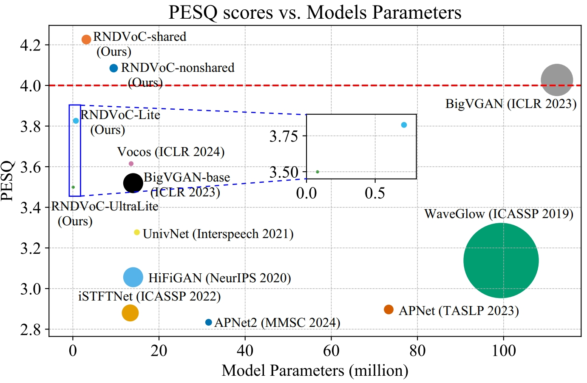
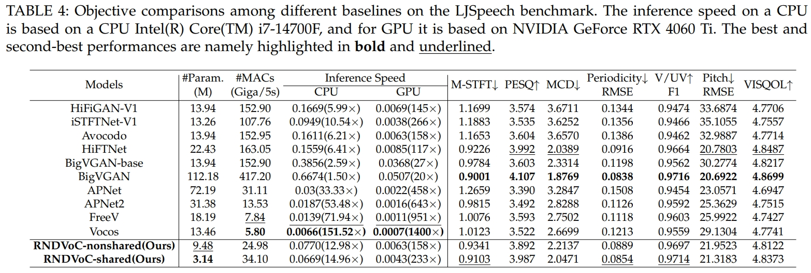
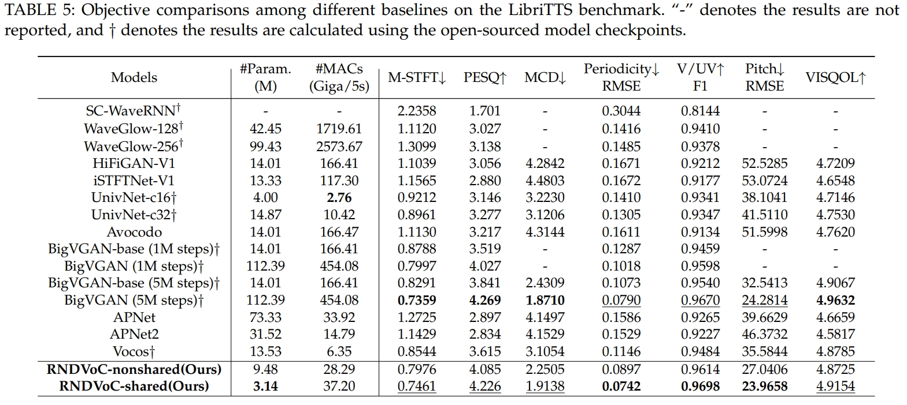
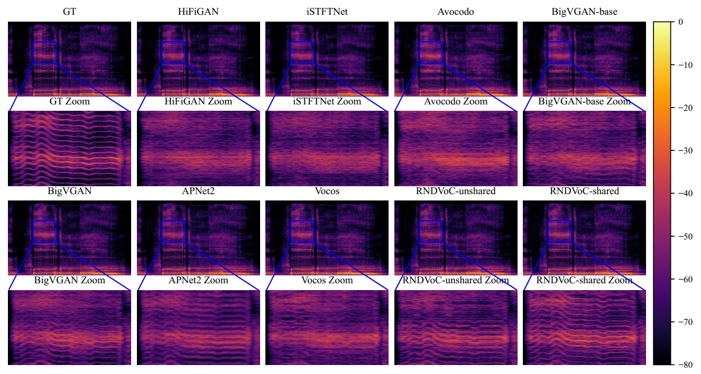
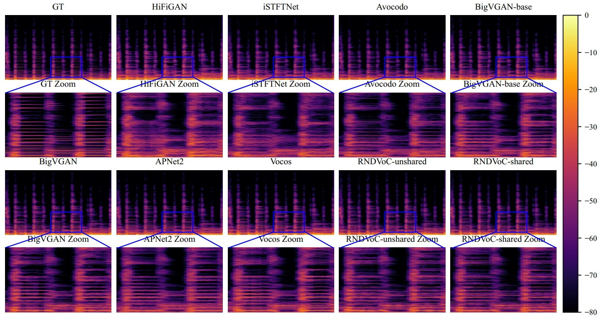
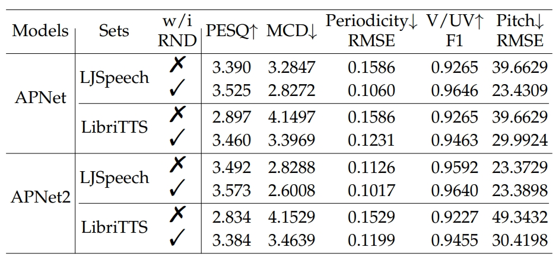
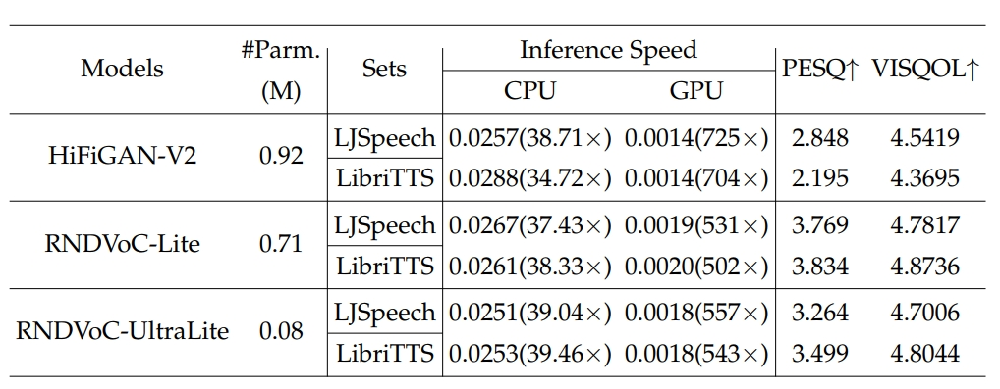

# Scalable Neural Vocoder from Range-Null Space Decomposition

### Authors: Andong Li, Tong Lei, Zhihang Sun, Rilin Chen, Xiaodong Li, Dong Yu, and Chengshi Zheng


## 📝 Overview
A novel neural vocoder framework based on Range-Null Space Decomposition (RND) that achieves state-of-the-art performance with remarkable efficiency and interpretability. Our approach bridges classical signal processing theory with modern deep learning, offering a scalable solution for high-quality speech synthesis.


## 📌 Key Updates
<details>
  <summary>📅 Full Update History</summary>
  <ul>
    <li><strong>2025.10.10</strong>: Project code and pretrained checkpoints released</li>
    <li><strong>2025.04.29</strong>: Accepted by IJCAI 2025 • Extended version submitted to TPAMI</li>
    <li><s>2025.01.09</s>: Repository initialized (archived)</li>
  </ul>
</details>


## 🔍 Abstract
Although deep neural networks have facilitated significant progress of neural vocoders in recent years, they usually suffer from intrinsic challenges like opaque modeling, inflexible retraining under different input configurations, and parameter-performance trade-off. These inherent hurdles can heavily impede the development of this field.

To resolve these problems, we propose a novel neural vocoder in the time-frequency (T-F) domain that bridges classical range-null decomposition (RND) theory with the vocoder task. The reconstruction of target spectrograms is formulated into the superimposition between range-space and null-space:
- **Range-space**: Projects mel-domain representations into linear-scale domain
- **Null-space**: Uses neural networks to infill spectral details

Our elaborate dual-path framework enables hierarchical spectrum encoding/decoding with cross- and narrow-band modules for effective sub-band and time dimension modeling. We also propose a strategy to transform multi-condition adaptation in inference into data augmentation during training.

Comprehensive experiments on LJSpeech and LibriTTS benchmarks show our framework achieves state-of-the-art performance while maintaining lightweight structure and scalable inference.


## ✨ Core Features
<div style="display: grid; grid-template-columns: repeat(auto-fit, minmax(300px, 1fr)); gap: 20px; margin: 30px 0;">
  <div style="background: #f8f9fa; padding: 20px; border-radius: 10px; border-left: 4px solid #3498db;">
    <h3>🎯 Decent Interpretability</h3>
    <p>Reformulates vocoder task from a signal-decomposition perspective (Range-Null Space Decomposition), providing clear interpretability.</p>
  </div>
  
  <div style="background: #f8f9fa; padding: 20px; border-radius: 10px; border-left: 4px solid #2ecc71;">
    <h3>⚡ Exceptional Efficiency</h3>
    <p>3.14M parameters • 34.10GMacs/5s • 10x speedup over BigVGAN-112M</p>
  </div>
  
  <div style="background: #f8f9fa; padding: 20px; border-radius: 10px; border-left: 4px solid #e74c3c;">
    <h3>🎧 Superior Reconstruction</h3>
    <p>Outperforms BigVGAN-112M and recent RFWave (by internal evaluations)</p>
  </div>
</div>


## 🚀 Quick Start

### 1️⃣ Checkpoint Download
Pre-trained models are available on Hugging Face:

| Model Name | Dataset | Sample Rate | NMel | Training Steps |
|------------|---------|-------------|------|----------------|
| 🤗 [RNDVoC-LibriTTS](https://huggingface.co/AndongLi/RNDVoC/blob/main/best_g_libritts) | LibriTTS | 24k Hz | 100 | 2M (1M Generator + 1M Discriminator) |
| 🤗 [RNDVoC-LJSpeech](https://huggingface.co/AndongLi/RNDVoC/blob/main/best_g_ijs) | LJSpeech | 22.05k Hz | 80 | 2M (1M Generator + 1M Discriminator) |


### 2️⃣ Inference Examples

#### From Natural Mel Spectrograms
Reconstruct audio from mels extracted from original waveforms:
#!/bin/bash
CUDA_VISIBLE_DEVICES=0 python3 inference.py \
                        --cfg_filename ./cfgs/libritts/mid_rnd_shared_ende_libritts_config.json \
                        --test_input_wavs_dir ./test_wavs \
                        --test_output_dir ./test_wavs_est \
                        --checkpoint_file_load ./Experiments/LibriTTS/RNDVoc_shared_ende_benchmark/best_g_libritts
#### From Synthesized Mel Spectrograms
Generate waveforms from synthesized mels (common in TTS/T2A systems):
CUDA_VISIBLE_DEVICES=0 python3 inference.py  \
                           --cfg_filename ./cfgs/libritts/mid_rnd_shared_ende_libritts_config.json \
                           --use_mel_format \
                           --test_input_mels_dir ./test_wavs \
                           --test_output_dir ./test_wavs_est \
                           --checkpoint_file_load ./Experiments/LibriTTS/RNDVoc_shared_ende_benchmark/best_g_libritts

### 3️⃣ Training with Custom Dataset
<details>
  <summary>📋 Step-by-Step Training Guide</summary>
  
  1. Prepare your scp files for training/validation and place them in `./DatasetsScp`
  2. Modify configuration json files (e.g., `./cfg/libritts/mid_rnd_shared_ende_libritts_config.json`) with:
     - `input_training_wav_list`
     - `input_validation_wav_list`
     - `raw_wavfile_path`
     - `checkpoint_path`
  3. Adjust the `get_dataset_filelist` function in `dataset.py` to match your wavfile format in the scp
  4. Start training:
     ```bash
     ./train.sh
     ```
</details>


## 📊 Experimental Results

### Performance Comparison
<div style="margin: 20px 0;">
  <h4>🎯 Bubble Figure on LibriTTS Benchmark</h4>
  
</div>

<div style="display: grid; grid-template-columns: 1fr 1fr; gap: 20px; margin: 20px 0;">
  <div>
    <h4>📈 On LJSpeech Benchmark</h4>
    
  </div>
  <div>
    <h4>📈 On LibriTTS Benchmark</h4>
    
  </div>
</div>


### Spectral Visualizations
<h4>🎵 MUSDB18 Test Set Analysis</h4>

<div style="margin: 20px 0;">
  <h5>Vocal Voice</h5>
  
</div>

<div style="margin: 20px 0;">
  <h5>Bass Sound</h5>
  
</div>


### Plug-and-Play Capability
<div style="margin: 20px 0;">
  <h4>🔌 Applying RND to Existing T-F Domain Vocoders</h4>
  
</div>


### Lightweight Design
<div style="margin: 20px 0;">
  <h4>💡 Toward Light-weight Architecture</h4>
  
</div>


## 📚 Citation
If you find this work helpful, please cite our paper:
@inproceedings{ijcai2025p904,
  title     = {Learning Neural Vocoder from Range-Null Space Decomposition},
  author    = {Li, Andong and Lei, Tong and Sun, Zhihang and Chen, Rilin and Yin, Erwei and Li, Xiaodong and Zheng, Chengshi},
  booktitle = {Proceedings of the Thirty-Fourth International Joint Conference on
               Artificial Intelligence, {IJCAI-25}},
  publisher = {International Joint Conferences on Artificial Intelligence Organization},
  editor    = {James Kwok},
  pages     = {8131--8140},
  year      = {2025},
  month     = {8},
  note      = {Main Track},
  doi       = {10.24963/ijcai.2025/904},
  url       = {https://doi.org/10.24963/ijcai.2025/904},
}

## 🤝 Contributing
We welcome contributions! Please feel free to submit issues, fork the repository, and send pull requests.


<div align="center">
  <p style="margin-top: 40px; color: #666;">
    Made with ❤️ by the RNDVoC team
  </p>
</div>


